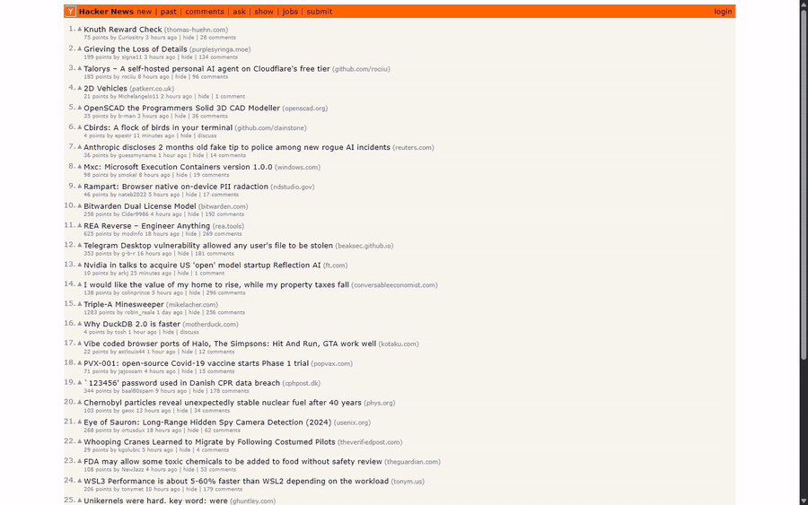
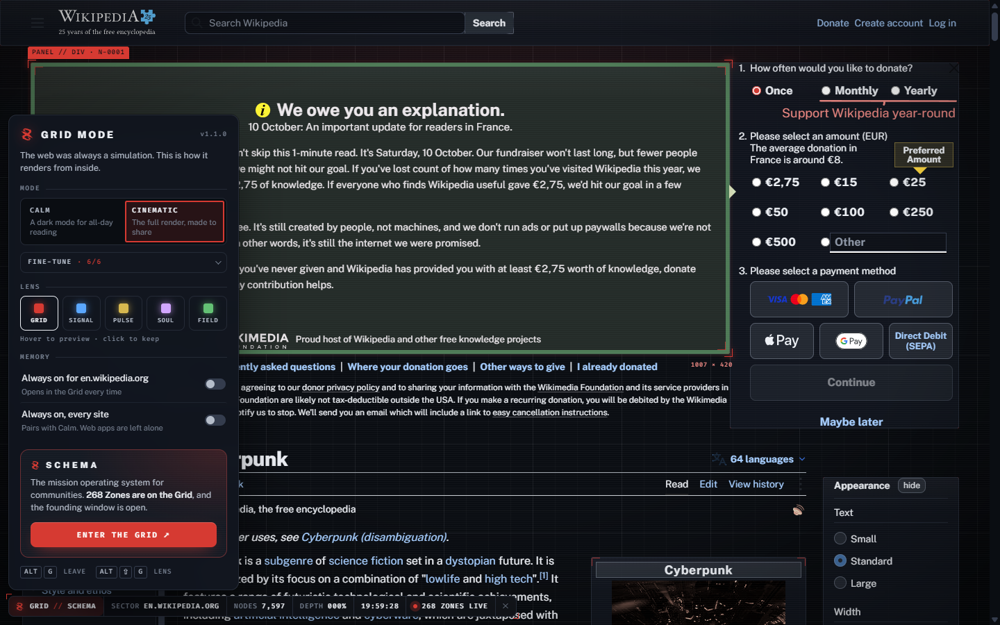

# Grid Mode

**Press Alt+G on any website and see it rendered from inside the Grid.**

A userscript by [Schema](https://schema.cx/?ref=grid-mode-github). It repaints any page as a Schema terminal; press Alt+G again and the page is exactly what it was.

## Install

1. Install a userscript manager in your browser.
2. Open [`grid-mode.user.js`](grid-mode.user.js?raw=1) and confirm the install.
3. Press **Alt+G** (⌥+G on a Mac) on any page.

## Two modes

| | **Calm** | **Cinematic** |
|---|---|---|
| For | All-day reading. Leave it on for every site. | The full render, made to share. |
| Look | Navy Schema surfaces, cards on Schema's radius scale, colours that keep their meaning. The site's own typefaces. | Schema type everywhere, sharp HUD cards with hairline corner brackets, duotone images (hover for true colour). |
| Life | A quiet dot grid behind the page. | A scan line boots the page, target-lock brackets name whatever you point at, headlines decode as they scroll in, a cursor light on the grid, scanlines and a slow signal sweep. |

**Five lenses** (GRID, SIGNAL, PULSE, SOUL, FIELD), previewed live as you hover. **Alt+Shift+G** cycles them.

## Small things that matter

- **It follows you.** Turn it on and it stays on as you browse that site in that tab, until you leave it. "Always on" makes it permanent per site, or for the whole web.
- **Web apps are left alone.** "Every site" skips document editors, design canvases, maps and video calls.
- **The toolbar folds away.** Minimise it to a single mark; hover to peek; pin it open again.
- **Accessible.** Keyboard-operable panel, visible focus, and reduced-motion respected: no scan, sweep, parallax or decoding.

## Fast by design

Each element is read once, while it is still unpainted, and marked with a single attribute. The stylesheet paints only marked elements, so a page's original colours can always be read directly; nothing is ever switched off and on again. New content is read in a MutationObserver callback, before the browser paints it. The background grid is drawn once into a 128 px tile at your screen's own pixel density.

Measured on a 17,000-element encyclopedia article while scrolling for 10 seconds: **0.17 s** of long tasks with the Grid on, against **0.11 s** for the plain page.

## Privacy

No analytics, no tracking, no identifiers. While the Grid is on, the toolbar asks `api.schema.cx` for one public, cookieless number (how many Zones are live), at most once every 30 minutes. Your settings stay in your userscript manager.

## Some things in the Grid are found, not explained.

Read the source.

---

Grid Mode is made by **Schema**, the mission operating system for communities. **[Enter the Grid ↗](https://schema.cx/?ref=grid-mode-github)**

MIT licensed.
